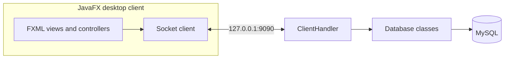

# SALON

Настольная система для работы салона красоты: запись клиентов, каталог услуг, расписание мастеров и управление сотрудниками. Проект состоит из JavaFX-клиента, отдельного Java-сервера и базы MySQL.

   

## Возможности

| Роль | Доступные сценарии |
| --- | --- |
| Клиент | Регистрация и вход, просмотр услуг и мастеров, выбор времени и запись, просмотр своих записей, отзыв |
| Сотрудник | Просмотр своих записей, профиля и статистики |
| Администратор | Управление услугами, мастерами, пользователями и расписанием, просмотр записей и отзывов |

В интерфейсе предусмотрены разные экраны для ролей. Сервер обрабатывает запросы клиентов и выполняет операции с MySQL через JDBC.

## Как устроен проект



| Каталог | Содержимое |
| --- | --- |
| [`Client/`](Client/) | JavaFX-приложение, FXML-экраны и обмен с сервером |
| [`Server/`](Server/) | Сокетный сервер, обработчик запросов, JDBC и модели данных |
| [`database/schema.sql`](database/schema.sql) | Схема таблиц и связей для локального запуска |
| [`pom.xml`](pom.xml) | Общая Maven-сборка двух модулей |

Клиент и сервер обмениваются Java-объектами через локальное TCP-соединение. Сервер слушает только `127.0.0.1:9090`; проект рассчитан на локальную демонстрацию.

### Данные

Схема содержит восемь таблиц: `users`, `clients`, `employees`, `services`, `employee_services`, `schedule_slots`, `appointments` и `reviews`. Связи между ними заданы внешними ключами. SQL-файл составлен по текущим запросам в коде; полный прогон всех пользовательских сценариев с MySQL ещё требуется.

## Запуск

Нужны JDK 23+, Maven 3.8+ и MySQL 8. Клиент использует JavaFX 23; сервер собирается для Java 17.

1. Создайте базу из [`database/schema.sql`](database/schema.sql). В консоли MySQL:

   ```sql
   SOURCE /полный/путь/к/SALON/database/schema.sql;
   ```

2. Создайте пользователя MySQL с правами `SELECT`, `INSERT`, `UPDATE`, `DELETE` для базы `hairsalon` и задайте параметры подключения. Пример для PowerShell:

   ```powershell
   $env:SALON_DB_URL = 'jdbc:mysql://localhost:3306/hairsalon'
   $env:SALON_DB_USER = 'salon_app'
   $env:SALON_DB_PASSWORD = '<пароль вашей локальной БД>'
   ```

3. Из корня проекта проверьте сборку:

   ```bash
   mvn test
   ```

4. В первом терминале запустите сервер:

   ```bash
   cd Server
   mvn exec:java
   ```

5. Во втором терминале запустите клиент:

   ```bash
   cd Client
   mvn javafx:run
   ```

Адрес и порт клиента заданы в [`BarberShopClient.java`](Client/src/main/java/BarberShopClient.java). При запуске без сервера клиент не подключится. Если требуется роль администратора для локального знакомства с интерфейсом, её можно назначить зарегистрированному пользователю в собственной тестовой базе:

```sql
UPDATE users SET role = 'admin' WHERE login = '<ваш тестовый логин>';
```

## Проверка

`mvn test` компилирует оба модуля и запускает тесты сервера. Тесты на встроенной H2 проверяют резервирование слотов, отказ при повторной записи, отмену записи и откат при ошибках сохранения или освобождения слотов. Создание и отмена записи выполняются отдельными транзакциями. Тест соединения с MySQL включается отдельно переменной `SALON_TEST_DB=true` и требует настроенной тестовой базы. Проверены запуск сервера на локальном порту и старт JavaFX-клиента до попытки соединения; полный проход интерфейса с базой данных пока не подтверждён.

## Ограничения и следующие шаги

- Для запуска нужны локальные MySQL и два процесса; готового контейнерного окружения пока нет.
- Сетевой протокол использует Java-сериализацию и не предназначен для открытого интернета.
- В ближайших этапах: сквозные проверки записи на услугу, проверка прав на сервере, улучшение обработки ошибок подключения и документация экранов.

Проект публикуется как исходный код для локального изучения и дальнейшей разработки, а не как готовый сервис для публичного развёртывания.
